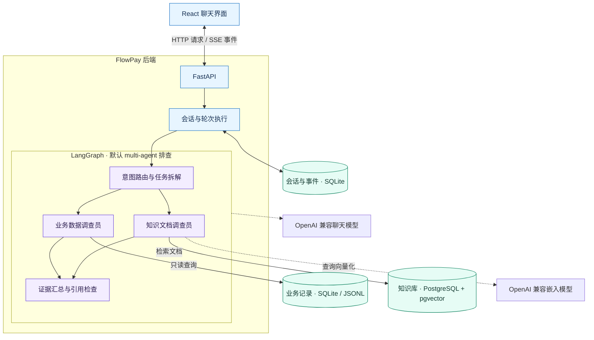

# FlowPay Agentic RAG

围绕虚构支付平台的客服场景，搭一套 Agentic RAG 系统。模型不是拿到问题就检索一次然后回答，而是自己决定查什么、查几轮、先查哪个：规则类的问题检索文档，业务结论要靠 SQL 工具查真实记录，工具返回的行才算已核实的事实。

多轮对话里，条件跨轮累积——用户前面给过的编号、环境、状态，下一轮直接当查询条件用，不再重复问。条件不足以发起查询时先问用户缺哪几项；只缺一项时，先把查得动的查完再带着结果去问。用户改口（"改成 xxx"）时，基于旧值查到的结论作废，用新条件重查。

排查默认走多 Agent 并行：意图路由后拆解子任务，业务数据与知识文档两类调查员并行取证，最后合并作答；多跳问题的第二跳检索自动携带第一跳查得的结论值，不再盲查。

整套链路带鲁棒性护栏：工具链路确定性失败时该链路当轮禁用，任务携带已查发现收束，后续调用不再请求已失效链路；调查中途失败可从子任务断点续跑，已完成的查询不重查；汇总结论必须带引用标记，无引用的断言句确定性降级为「未能核实」口径，查不到的不硬答、不虚构；单个子任务的工具调用有预算上限，超限即收束并携带已查发现返回。只有模型不可用、配额拒绝这类硬失败才整轮报错。

代码结构刻意分层：`backend/src/flowpay/core` 是通用能力层（Agent、LLM、知识检索、业务工具、HTTP、事件日志），`backend/src/flowpay/workflows/` 每个阶段一个文件/包，只写编排、提示词和业务决策，不碰底层实现。前端是一个 React 聊天界面，能看到每轮的工具调用、事件流和用量。

## 项目架构



图中是默认的排查主链：按需并行取证，汇总后作答。文档直答和闲聊不走完整排查链路；运行事件持久化后通过 SSE 送回前端，刷新后也可回放。

## 前置条件

| 需要什么 | 说明 |
| --- | --- |
| Docker Desktop | 全部服务都在容器里跑 |
| 聊天模型密钥 | 任何 OpenAI 兼容服务都行，默认用 DeepSeek |
| 数据包 | 100 篇支付客服知识文档（向量已预建）、300 题评测集、业务模拟数据与 PostgreSQL dump |

## 快速开始

```bash
cp .env.example .env     # 填 FLOWPAY_MODEL_API_KEY 和 FLOWPAY_DATASET_ROOT 两项
make up
```

跑完打开 <http://127.0.0.1:5173/>，接口在 <http://127.0.0.1:8000/>。

## 常用命令

```
make up        起全栈（BUILD=1 强制重建镜像）
make down      停容器，数据卷保留
make logs      跟踪后端与前端日志
make help      列出全部目标
```

## License

[MIT](LICENSE)
